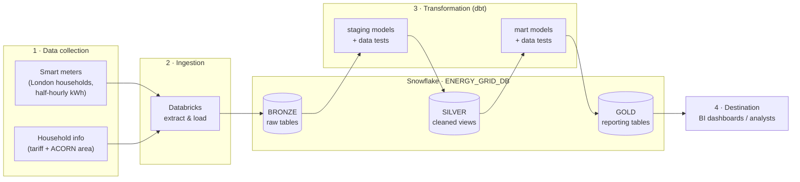
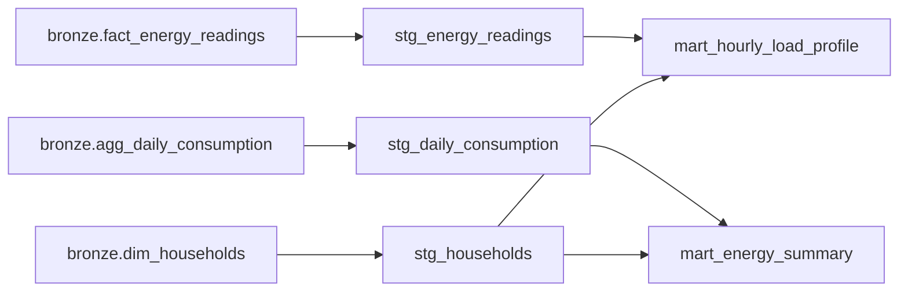

# Energy Grid Analytics — dbt + Snowflake


An end-to-end analytics engineering project that turns raw household smart-meter
readings into reporting tables that answer:

- **How much energy do different areas use each day?**
- **When during the day does demand peak, and do time-of-use tariff customers shift their load?**

It follows the **medallion architecture** (Bronze → Silver → Gold) on **Snowflake**, with all
transformations, tests and documentation written in **dbt**.

---

## Architecture



| Stage | Where | What happens |
|---|---|---|
| **Collect** | Smart meters, household register | Half-hourly kWh per meter, plus each household's tariff and ACORN area group |
| **Ingest** | Databricks | Loads the raw files into Snowflake `BRONZE` |
| **Clean (Silver)** | dbt staging → Snowflake `SILVER` | Rename, cast and standardise columns; drop negative readings, missing meter ids and incomplete days |
| **Model (Gold)** | dbt marts → Snowflake `GOLD` | Join readings to households and aggregate by area, tariff, day and hour |
| **Consume** | BI tool / SQL | Dashboards on daily consumption and load profiles |

## dbt lineage



## Models

### Bronze (sources)
| Table | Grain | Key columns |
|---|---|---|
| `fact_energy_readings` | meter × 30-min slot | `LCLID`, `TSTP`, `ENERGY_KWH_PER_HR` |
| `agg_daily_consumption` | meter × day | `LCLID`, `DATE`, `TOTAL_KWH_DAY`, `AVG_KWH_PER_SLOT`, `PEAK_KWH` |
| `dim_households` | meter | `LCLID`, `STDORTOU` (tariff), `ACORN`, `ACORN_GROUPED` (area group) |

### Silver (views)
| Model | Grain | What it does |
|---|---|---|
| `stg_energy_readings` | meter × 30-min slot | Clean readings, adds `reading_date` and `reading_hour`, removes negative/invalid rows |
| `stg_daily_consumption` | meter × day | Clean daily totals, removes incomplete days |
| `stg_households` | meter | Tariff decoded to `Standard` / `Time of Use`; `area_group` = Affluent / Comfortable / Adversity |

### Gold (tables)
| Model | Grain | Answers |
|---|---|---|
| `mart_energy_summary` | day × area group × tariff | Daily total kWh, active meters, average kWh per meter, highest half-hour peak |
| `mart_hourly_load_profile` | area group × tariff × hour of day | Average kWh per meter for each hour, showing the evening peak and tariff effect |

> **Area** here is the dataset's ACORN classification. ACORN groups postcode areas by
> socio-demographic profile (Affluent, Comfortable, Adversity), which is the area attribute
> the London smart-meter data provides.

## Data quality

`dbt build` runs **24 data tests** alongside the models:

| Check | Applied to |
|---|---|
| `not_null` | All keys and measures |
| `unique` / `unique_combination` (custom generic test) | Table grain: meter × timestamp, meter × day, day × area × tariff, and so on |
| `relationships` | Every reading and daily row belongs to a known household |
| `accepted_values` | Tariff type and area group |
| `assert_daily_total_matches_readings` (singular test) | Daily totals reconcile with the sum of half-hourly readings (±0.01 kWh) |

## Project structure

```
├── models/
│   ├── staging/          # Silver: sources.yml, stg_* models, schema.yml (docs + tests)
│   └── marts/            # Gold: mart_* models, schema.yml
├── macros/
│   ├── generate_schema_name.sql   # write to SILVER / GOLD exactly (no target-schema prefix)
│   └── bronze_source.sql          # Snowflake: real BRONZE source · local: sample seed
├── tests/
│   ├── generic/unique_combination.sql
│   └── assert_daily_total_matches_readings.sql
├── seeds/sample_bronze/  # synthetic Bronze sample data (local runs only)
├── scripts/generate_sample_data.py
├── profiles.yml          # targets: local (DuckDB) and snowflake (env vars, no secrets)
└── .github/workflows/dbt-ci.yml   # builds + tests the project on every push / PR
```

## Running it

### Option A — local, no cloud account needed (DuckDB)

Runs the full pipeline on a small synthetic dataset shaped like the real Bronze tables
(8 households, 3 days of half-hourly readings, plus a few deliberately dirty rows).

```bash
pip install -r requirements.txt
dbt build --profiles-dir .
```

```
Finished running 3 seeds, 2 table models, 24 data tests, 3 view models
Done. PASS=32 WARN=0 ERROR=0 SKIP=0
```

Explore the results:

```bash
dbt show --profiles-dir . --inline "select * from {{ ref('mart_energy_summary') }}"
dbt docs generate --profiles-dir . && dbt docs serve --profiles-dir .
```

### Option B — Snowflake (production)

1. Load the raw data into `ENERGY_GRID_DB.BRONZE` (`fact_energy_readings`, `agg_daily_consumption`, `dim_households`).
2. `pip install dbt-snowflake`
3. Set credentials as environment variables:
   `SNOWFLAKE_ACCOUNT`, `SNOWFLAKE_USER`, `SNOWFLAKE_PASSWORD`, optionally `SNOWFLAKE_ROLE` and `SNOWFLAKE_WAREHOUSE`.
4. Run:

```bash
dbt build --profiles-dir . --target snowflake
```

On Snowflake the sample seeds are disabled, so the real Bronze tables are never overwritten.

## Sample output (local run)

`mart_energy_summary` totalled over the 3 sample days:

| area_group | tariff_type | total_kwh |
|---|---|---|
| Affluent | Standard | 114.68 |
| Affluent | Time of Use | 55.05 |
| Comfortable | Standard | 86.64 |
| Comfortable | Time of Use | 41.14 |
| Adversity | Standard | 31.97 |
| Adversity | Time of Use | 31.37 |

In `mart_hourly_load_profile`, the 18:00 evening peak is 2.2–2.4× the 03:00 overnight load.
Time-of-use households draw 17–21% less at the peak than standard-tariff households
in the same area group. *(These figures come from synthetic sample data and only demonstrate
the pipeline; they are not real findings.)*

## Tech stack

Snowflake · dbt Core · Databricks (ingestion) · DuckDB (local dev / CI) · GitHub Actions
